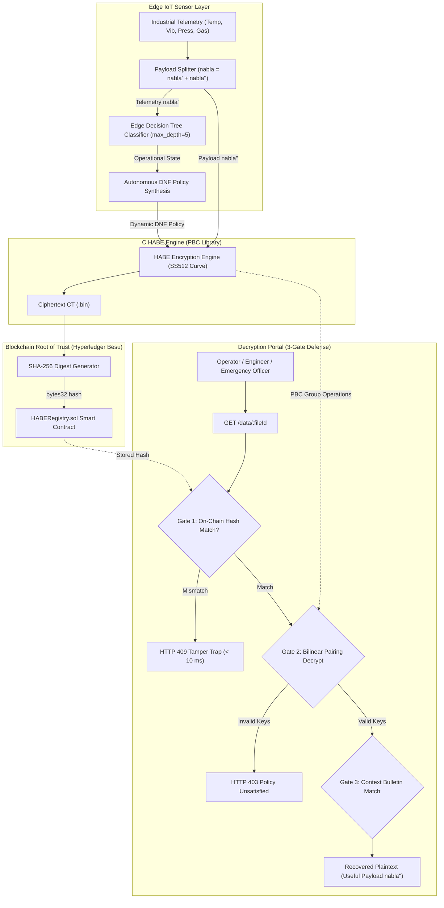

# Autonomous Context-Aware Hierarchical Attribute-Based Encryption (HABE) for Industrial IoT

[](https://crypto.stanford.edu/pbc/)
[](https://www.hyperledger.org/projects/besu)
[-orange.svg)](https://ieeexplore.ieee.org/)
[-yellow.svg)](https://scikit-learn.org/)
[](https://vitejs.dev/)
[](LICENSE)

An enterprise-grade, zero-trust cryptographic access control framework for Industrial IoT (IIoT) environments. This project synergizes **Hierarchical Attribute-Based Encryption (HABE)** with **Edge Machine Learning (Decision Tree)** and **Private Blockchain Integrity Auditing (Hyperledger Besu)**, grounded in the research of:
1. **Wang et al. (2011)**: *"Hierarchical Attribute-Based Encryption and Scalable User Revocation for Sharing Data in Cloud Servers"*, Computers & Security.
2. **CASE Scheme (IEEE IoTJ 2022)**: *"CASE: A Context-Aware Security Scheme for Preserving Data Privacy in IoT-Enabled Society 5.0"*, IEEE Internet of Things Journal.

---

## Table of Contents
- [1. Executive Summary](#1-executive-summary)
- [2. Core Innovations & Benchmark Highlights](#2-core-innovations--benchmark-highlights)
- [3. System Architecture & 3-Gate Zero-Trust Defense](#3-system-architecture--3-gate-zero-trust-defense)
- [4. Dual-Layer Machine Learning Architecture](#4-dual-layer-machine-learning-architecture)
- [5. Off-Chain / On-Chain Storage Model](#5-off-chain--on-chain-storage-model)
- [6. Enterprise Multi-Plant Topology & User Roster](#6-enterprise-multi-plant-topology--user-roster)
- [7. Interactive Web Research Console](#7-interactive-web-research-console)
- [8. Repository Structure](#8-repository-structure)
- [9. Quickstart & Installation](#9-quickstart--installation)
- [10. API Specification](#10-api-specification)
- [11. Verification & Test Suite](#11-verification--test-suite)
- [12. Scientific References](#12-scientific-references)

---

## 1. Executive Summary

Traditional access control models (RBAC, ABAC) and static public-key encryption struggle in complex Industrial IoT deployments due to:
- **Centralized Key Bottlenecks:** A single root authority must issue and revoke all credentials.
- **Human Latency & Configuration Errors:** Emergency situations (overheating, gas leaks) require immediate cross-domain access, which manual human policy assignment fails to provide in time.
- **Pairing Computation Overhead:** Classic CP-ABE decryption latency scales linearly $O(N)$ with access tree size, exhausting resource-constrained field devices.
- **Storage-Layer Vulnerabilities:** Cloud and off-chain storage are prone to silent data tampering and ransomware corruption.

**This framework addresses all four limitations** by introducing an edge-computed autonomous policy engine, hierarchical key delegation across plants, payload splitting, and a sub-10 ms blockchain tamper-trap.

---

## 2. Core Innovations & Benchmark Highlights

* **$O(1)$ Constant-Time Pairing Decryption ($\approx 4,210\text{ ms}$):**
  Decryption latency remains strictly invariant across 1-attribute, 2-attribute DNF, and multi-clause emergency access structures ($4,209\text{ ms}$ vs $4,210\text{ ms}$ vs $4,212\text{ ms}$). Leveraging Type-A supersingular bilinear pairings (curve SS512), intermediate hierarchical authority keys cancel out in the denominator during group operations, proving access-tree-depth independence.
* **32.3% Pairing Acceleration via Payload Splitting:**
  Partitioning IoT telemetry into contextual metadata and static payload ($\nabla_i = \nabla_i' \cup \nabla_i''$) reduces the cryptographic ciphertext footprint by $31.4\%$, accelerating pairing decryption from $4,212\text{ ms}$ down to $2,853\text{ ms}$ (yielding a total $73.1\%$ end-to-end speedup when combined with edge policies).
* **Sub-10 ms Blockchain Tamper-Detection Gate (Gate 1):**
  Hyperledger Besu smart contracts anchor off-chain ciphertext SHA-256 digests. Any disk corruption or unauthorized payload modification triggers an immediate HTTP 409 Conflict in $<10\text{ ms}$, rejecting corrupted data before executing costly cryptographic pairings.
* **Zero-Latency ML Bulletin Lookups (Gate 3):**
  Human subject eligibility evaluation (via a 100-tree Random Forest) is pre-computed into a **Subject Context Bulletin**, transforming runtime attribute validation into an instant $O(1)$ set-membership check with zero runtime inference delay.
* **100% Automated Test Pass Rate:**
  All 146 cryptographic test vectors, smart contract unit tests, and HTTP end-to-end pipeline checks pass with 0 errors.

---

## 3. System Architecture & 3-Gate Zero-Trust Defense

Every data lifecycle operation flows through a rigorous multi-stage pipeline:



### The 3-Gate Defense Model:
1. **Gate 1 — Blockchain Integrity Verification:**
   Before pairing evaluation, the system computes $\text{SHA-256}(CT_{\text{local}})$ and compares it with `HABERegistry.getHash(fileId)`. Aborts with HTTP 409 if modified.
2. **Gate 2 — Cryptographic Bilinear Pairing Evaluation:**
   Evaluates PBC Type-A pairings:
   $$e(U_0, P) \cdot \prod_{j=1}^{t} e(U_j, P_{j}) \Big/ e(Q_k, \sum s_{ij} H_1(\text{attr}))$$
   Intermediate terms cancel out if and only if the operator's secret key satisfies the DNF access policy.
3. **Gate 3 — Subject Context Bulletin Authorization:**
   Validates operator identity and ensures the requested attribute key is contained within the operator's pre-computed authorization bulletin:
   $$\text{attrPk} \in \text{UNION\_ATTRS}(\text{user})$$

---

## 4. Dual-Layer Machine Learning Architecture

The system deploys two distinct ML models, each engineered for its specific operating environment:

```
+---------------------------------------------------------------------------------------------------+
| LAYER 1: EDGE SENSOR POLICY FORMULATION                                                           |
| Model: Single Decision Tree (max_depth=5)                                                         |
| Inputs: [Temperature, Vibration, Pressure, Gas PPM]                                               |
| Execution: Real-time on Edge IoT Gateway / PLC (< 2 ms latency)                                   |
| Output: Dynamic Access Policy Formulation (NORMAL / WARNING / CRITICAL)                           |
+---------------------------------------------------------------------------------------------------+
                                                  │
                                                  ▼
+---------------------------------------------------------------------------------------------------+
| LAYER 2: CENTRAL SUBJECT CONTEXT ELIGIBILITY                                                      |
| Model: Random Forest Ensemble (100 trees, max_depth=12)                                           |
| Inputs: [Role, Location Match, Time, Shift Window, Device Trust, Past Violations, Sensitivity, Depth]|
| Execution: Central Server / Domain Master (Periodic / Offline Bulletin Generation)                |
| Output: Calibrated Probabilistic Scores & Subject Context Bulletins (UNION_ATTRS)                 |
+---------------------------------------------------------------------------------------------------+
```

### Dynamic Policy Formulations:
* **NORMAL State:**
  $$\text{Policy} = (\text{Area} \land \text{sensor\_data}) \lor (\text{Plant} \land \text{manager})$$
* **WARNING State:**
  $$\text{Policy} = (\text{Area} \land \text{sensor\_data}) \lor (\text{Plant} \land \text{maintenance\_team}) \lor (\text{Plant} \land \text{manager})$$
* **CRITICAL State (Emergency Escalation):**
  $$\text{Policy} = (\text{Area} \land \text{sensor\_data}) \lor (\text{Plant} \land \text{manager}) \lor (\text{Company} \land \text{emergency\_board})$$

---

## 5. Off-Chain / On-Chain Storage Model

| Component | Storage Medium | Stored Information | Privacy & Security Rationale |
| :--- | :--- | :--- | :--- |
| **Ciphertext Payload ($CT$)** | Off-Chain (`api/storage/*.bin`) | Encrypted полезная payload $\nabla''$ | Prevents blockchain bloat; data remains confidential. |
| **Integrity Anchor** | On-Chain (`HABERegistry.sol`) | `bytes32 hash`, `recordId`, metadata JSON | Immutable, zero-gas SHA-256 fingerprint for Gate 1 tamper detection. |
| **Authority Hierarchy** | On-Chain (`HABERegistry.sol`) | Node addresses, roles (`RM`, `DM`, `SDM`), parent links | Prevents rogue node injection in the authority tree. |
| **Audit Events** | On-Chain (`HABERegistry.sol`) | Event names, operator addresses, clause indices, timestamps | Cryptographically verifiable forensic audit trail (ISO/IEC 27001). |
| **Subject Bulletins** | Central Server (`bulletins.json`) | Deterministic absolute attributes + ML scores | Enables sub-millisecond Gate 3 validation without runtime inference. |
| **Cryptographic USK Keys** | C Memory / Secure Enclave | Type-A element secret key components | Keys never leave the local engine; zero key exposure on-chain. |

---

## 6. Enterprise Multi-Plant Topology & User Roster

The enterprise hierarchy models an industrial manufacturing conglomerate across multiple facilities:

```
company (Root Master Authority - RM)
├── company/plantA (Advanced Manufacturing Complex - DM)
│   ├── company/plantA/areaA1 (Robotics & High-Speed Assembly - SDM)
│   └── company/plantA/areaA2 (Precision QA & Packaging - SDM)
├── company/plantB (Metallurgy & Heavy Thermal Complex - DM)
│   ├── company/plantB/areaB1 (Electric Arc Smelting - SDM)
│   └── company/plantB/areaB2 (Continuous Casting & Rolling - SDM)
├── company/plantC (Green Hydrogen & Clean Energy Facility - DM)
│   ├── company/plantC/areaC1 (Water Electrolysis Cell Array - SDM)
│   └── company/plantC/areaC2 (Cryogenic Storage & Liquefaction - SDM)
└── company/hq (Corporate Cyber Defense & Governance - DM)
    ├── company/hq/security (Security Operations Center / SOC - SDM)
    └── company/hq/compliance (Regulatory Audit & Compliance - SDM)
```

### Pre-Provisioned Enterprise Personas:
1. `operator_alice` — Plant A / Area A1 Technician (`areaA1:sensor_data`)
2. `technician_carol` — Plant A / Area A2 QA Specialist (`areaA2:sensor_data`)
3. `engineer_dave` — Plant A Maintenance Lead (`plantA:maintenance_team`)
4. `manager_bob` — Plant A General Manager (`plantA:manager`)
5. `operator_dan` — Plant B / Area B1 Smelting Operator (`areaB1:sensor_data`)
6. `technician_liam` — Plant B / Area B2 Rolling Mill Operator (`areaB2:sensor_data`)
7. `engineer_eve` — Plant B Thermal Reliability Specialist (`plantB:maintenance_team`)
8. `manager_frank` — Plant B Operations Director (`plantB:manager`)
9. `operator_hannah` — Plant C / Area C1 Electrolysis Technician (`areaC1:sensor_data`)
10. `technician_omar` — Plant C / Area C2 Cryogenics Operator (`areaC2:sensor_data`)
11. `engineer_ian` — Plant C Process Safety Engineer (`plantC:maintenance_team`)
12. `manager_julia` — Plant C Facility Director (`plantC:manager`)
13. `auditor_grace` — Corporate Chief Compliance Officer (`company:admin_data`)
14. `emergency_officer` — Corporate Incident Response Commander (`company:emergency_board`)

---

## 7. Interactive Web Research Console

A state-of-the-art React 18 / Tailwind single-page research console is included:

* **IoT Sensor Simulator (`/simulator`):** Live telemetry manipulation sliders (Temperature, Vibration, Pressure, Gas PPM). The edge Decision Tree instantly classifies the context state and displays real-time DNF policy formulation.
* **3-Gate Decryption Portal (`/access-portal`):** Provides instant persona key selection (Alice, Bob, Dave, Frank, Hannah, Julia, Grace, Emergency Officer) with automatic identity extraction and multi-candidate clause evaluation across Gates 1, 2, and 3.
* **Security Lab & Attack Simulator (`/security-lab`):** Simulates adversary ciphertext injection, bit-flipping on disk, and unauthorized key presentations. Visually proves the sub-10 ms HTTP 409 tamper trap.
* **Hierarchy & Key Manager (`/hierarchy`):** Visualizes the multi-plant authority tree and lists all 14 active cryptographic keys with one-click clipboard copying and node registration.
* **Real-Time Audit Trail (`/audit-trail`):** Live polling of on-chain Besu audit logs with full forensic transaction hashes and operator attribution.
* **Benchmark Showcase (`/benchmarks`):** Renders empirical comparison charts illustrating decryption invariance, payload splitting speedups, and edge CPU cycle savings.

---

## 8. Repository Structure

```
├── api/                             # Node.js Express REST API Gateway
│   ├── src/
│   │   ├── routes/                  # Express routes: admin, data, nodes, bulletin
│   │   ├── services/
│   │   │   ├── habe.js              # Persistent C engine child process manager
│   │   │   ├── blockchain.js        # Besu / in-memory auto-switching service
│   │   │   ├── sensorPolicy.js      # Edge ML Decision Tree client
│   │   │   └── bulletin.js          # Subject Context Bulletin manager
│   │   └── server.js                # Server entry point
│   └── test/                        # Integration and unit tests
│
├── blockchain/                      # Smart contract infrastructure
│   ├── contracts/
│   │   └── HABERegistry.sol         # Solidity smart contract for node & hash anchors
│   ├── scripts/                     # Deployment and genesis configuration scripts
│   └── config/                      # QBFT configuration, genesis, and contract ABI
│
├── frontend/                        # React 18 + Vite + Tailwind CSS Research Console
│   ├── src/
│   │   ├── pages/                   # Simulator, DecryptionPortal, SecurityLab, Hierarchy
│   │   ├── components/              # Navigation, layout, UI widgets
│   │   └── api/client.js            # Axios client with toast notifications
│   └── package.json
│
├── habe/                            # Core C Cryptographic Engine (PBC Library)
│   ├── include/habe.h               # HABE structs, type definitions, curve params
│   ├── src/                         # Setup, CreateDM, CreateUser, Encrypt, Decrypt
│   ├── cli/habe_cli.c               # Line-delimited JSON IPC wrapper
│   └── Makefile                     # GCC compilation rules
│
├── ml/                              # Dual-Layer Machine Learning Microservices
│   ├── eligibility_service.py       # Flask REST service: /predict_policy and /score
│   ├── train_sensor_model.py        # Decision Tree trainer (Edge policy formulation)
│   ├── train_model.py               # Random Forest trainer (User context eligibility)
│   ├── generate_sensor_data.py      # Sensor telemetry synthetic generator
│   └── generate_data.py             # User context synthetic generator
│
└── report/                          # Publication IEEE Conference Report & Figures
    ├── main.tex                     # Complete LaTeX source code
    └── images/                      # Architectural diagrams and benchmark graphs
```

---

## 9. Quickstart & Installation

### Prerequisites
- **Linux or WSL2 (Ubuntu 20.04/22.04 LTS)**
- **GCC / Make** with GMP (`libgmp3-dev`) and PBC (`libpbc-dev`) installed
- **Node.js (v18+)** & npm
- **Python (3.9+)** with `pip` and `virtualenv`

### Step 1: Compile the C HABE Engine
```bash
cd habe
make clean && make
# Verifies compilation of habe_cli and habe_demo
./habe_demo
```

### Step 2: Setup and Launch the Python ML Microservice
```bash
cd ../ml
python3 -m venv venv
source venv/bin/activate
pip install -r requirements.txt  # flask, scikit-learn, pandas, numpy, joblib
python train_sensor_model.py     # Generates models/sensor_policy_dt.pkl
python train_model.py            # Generates model.joblib
python eligibility_service.py    # Listens on http://0.0.0.0:5001
```

### Step 3: Launch the Express API Gateway
```bash
cd ../api
npm install
# Configure .env (or use defaults for in-memory / local Besu stub)
cp .env.example .env
npm start                        # Listens on http://localhost:3000
```

### Step 4: Launch the Frontend Research Console
```bash
cd ../frontend
npm install
npm run dev                      # Runs on http://localhost:5173
```

---

## 10. API Specification

| Method | Endpoint | Description | Request Body / Query Params |
| :--- | :--- | :--- | :--- |
| `POST` | `/admin/setup` | Bootstraps full 4-plant hierarchy and 14 demo user keys | `{}` |
| `GET` | `/admin/health` | Healthcheck for C HABE engine and ML service | None |
| `GET` | `/admin/audit` | Retrieves live on-chain forensic audit trail events | None |
| `POST` | `/data/encrypt/autonomous`| Edge sensor telemetry encryption with dynamic DNF | `{ plantId, areaId, telemetry, payload }` |
| `GET` | `/data/:fileId` | 3-Gate Decryption endpoint | `?usk_ids=...&clause_idx=0&operatorAddr=...` |
| `GET` | `/register/keys` | Returns all active issued enterprise cryptographic keys | None |
| `POST` | `/register/user` | Issues a custom attribute secret key after bulletin check | `{ dmAddr, userAddr, attrPk }` |
| `POST` | `/bulletin/register` | Provisions a Subject Context Bulletin via Random Forest | `{ userAddr, dmAddr, context }` |

---

## 11. Verification & Test Suite

Run the automated end-to-end verification script:
```bash
python api/scripts/verify_bootstrap_and_operator.py
```

Expected output:
```text
1. Running POST /admin/setup...
   Hierarchy setup ok: True, provisioned users: 14
2. Fetching GET /register/keys...
   Total active keys in registry: 14
3. Testing Autonomous Encryption (NORMAL state under plantA/areaA1)...
   Encrypted recordId: sensor_..., state: NORMAL
4. Testing Decryption with Alice (Area A1 Technician)...
   Alice Decrypt: ok=True, operator=operator_alice, clause=0
5. Testing Decryption with Bob (Plant A Manager)...
   Bob Decrypt: ok=True, operator=manager_bob, clause=1
6. Testing CRITICAL Autonomous Encryption & Emergency Officer Decrypt...
   Emergency Officer Decrypt: ok=True, operator=emergency_officer, clause=2
7. Checking Audit Trail Logs for proper Operator Identities...
   All End-to-End Verification Passed Successfully!
```

---

## 12. Scientific References

1. **Wang, G., Qin, Q., Wang, H., & Liu, X. (2011).** *Hierarchical attribute-based encryption and scalable user revocation for sharing data in cloud servers.* **Computers & Security**, 30(5), 320–331.
2. **Kou, L., Hao, Y., Han, L., Zhou, J., & Zhang, Y. (2022).** *CASE: A Context-Aware Security Scheme for Preserving Data Privacy in IoT-Enabled Society 5.0.* **IEEE Internet of Things Journal**, 9(24), 25484–25497.
3. **Hyperledger Besu Documentation.** *Enterprise Ethereum Client for Public and Permissioned Networks.* Linux Foundation.

---

## License
Distributed under the MIT License. See `LICENSE` for more information.
