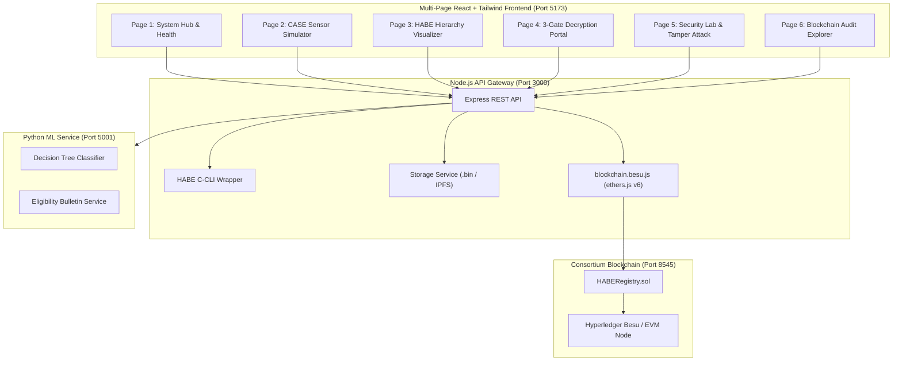

# Implementation Plan: Interactive Dashboard & Live Blockchain Deployment

This document outlines the implementation strategy for:
1. **Option 1: Multi-Page Interactive Dashboard (React + Tailwind CSS)** — A clean, modern, multi-page application that separates and visualizes each tier of the CASE + HABE + Blockchain pipeline.
2. **Option 2: Live Blockchain Deployment (Hyperledger Besu / EVM Node)** — Transitioning from in-memory stubbing to real on-chain transaction execution with `BESU_ENABLED=true`.

---

## Architecture Blueprint



---

# PART 1: OPTION 1 — MULTI-PAGE INTERACTIVE DASHBOARD

Rather than a crowded single-page layout, the frontend is structured into dedicated, modular pages so that each cryptographic and ML process is clearly understood and easily demonstrated.

### Tech Stack & Design Standards
* **Framework:** React 19 / 18 + Vite (fast build, HMR, modern ES modules).
* **Styling:** Tailwind CSS (latest v4 / v3.4) with minimal, modern typography, subtle borders (`border-slate-800`), crisp status indicators, and clean cards.
* **Routing:** `react-router-dom` (v6 / v7).
* **Icons:** `lucide-react` for clean, professional industrial/cryptographic symbols.
* **State & Networking:** Axios with custom polling/hooks for real-time sensor streams and backend sync.
* **Modular Component Slots:** Structured so you can seamlessly drop in your custom UI components into any page.

---

## Page Breakdown & Responsibilities

### Page 1: System Overview & Architecture Hub (`/`)
* **Purpose:** Command center showing real-time health across all 4 system layers.
* **Key Visuals & Components:**
  * **Service Health Cards:** Real-time ping indicators for Node.js Gateway (`:3000`), Python ML Microservice (`:5001`), HABE C-CLI engine, and Blockchain node (`:8545`).
  * **Pipeline Architecture Diagram:** Interactive diagram highlighting active components during data flow.
  * **Live Metrics Ribbon:** Counter badges for Total Records Encrypted, Tamper Attacks Intercepted, Active Nodes on Chain, and Current Block Number.
  * **Quick Navigation:** Jump cards to test individual pipeline stages.

---

### Page 2: CASE Edge Telemetry Simulator & Policy Engine (`/telemetry`)
* **Purpose:** Visualizes **Algorithm 1 & Data Splitting** from the CASE research paper.
* **Key Visuals & Components:**
  * **Industrial Sensor Controls:**
    * Temperature Slider (0°C to 120°C).
    * Vibration Slider (0.0 to 10.0 mm/s).
    * Pressure Slider (0 to 180 PSI).
    * Toxic Gas PPM Slider (0 to 300 PPM).
    * *Presets:* "Factory Normal", "High Vibration Warning", "Gas Leak Critical Spike".
  * **Decision Tree Live Classification Card:**
    * Displays the predicted state (`NORMAL` 🟢, `WARNING` 🟡, `CRITICAL` 🔴) updated in real-time.
    * Latency & CPU cycle badge (citing CASE Table III: 2.16s, $4.31 \times 10^3$ cycles).
  * **Dynamic DNF Formula Viewer:**
    * Syntax-highlighted HABE policy string dynamically generated by the ML layer:
      * `NORMAL`: `"({plantId}/{areaId} AND sensor_data) OR ({plantId} AND manager)"`
      * `CRITICAL`: `"({plantId}/{areaId} AND sensor_data) OR ({plantId} AND manager) OR (company AND emergency_board)"`
  * **Autonomous Encrypt Panel:**
    * Input payload box (e.g. `"TURBINE_RPM=3200;TEMP=84C"`).
    * Button: **"Encrypt & Anchor On-Chain"** $\rightarrow$ calls `POST /data/encrypt/autonomous`.
    * Output: Record ID, Ciphertext Hash (SHA-256), Transaction Hash, and off-chain storage path.

---

### Page 3: HABE Hierarchy & Node Manager (`/hierarchy`)
* **Purpose:** Manage and visualize the hierarchical domain tree and bilinear pairing root invariant.
* **Key Visuals & Components:**
  * **Hierarchical Tree Visualizer:**
    * Root Master (RM): `company` (Depth 1, $P_1 = H_1(\text{"company"}))$.
    * Domain Masters (DM): `company/plantA`, `company/plantB` (Depth 2).
    * Sub-Domain Masters (SDM): `company/plantA/areaA1`, `company/plantA/areaA2` (Depth 3).
  * **Node Registration Form:**
    * Provision new DMs or SDMs (`POST /register`).
  * **Attribute Key Issuance Panel:**
    * Issue user attribute secret keys (`POST /register/user`) with context validation.
  * **Cryptographic Parameter Inspector:**
    * Displays Domain Master Public Keys (`dm_pks`) and bilinear group parameters ($e(P, Q)$).

---

### Page 4: 3-Gate Decryption & Access Control Portal (`/access-portal`)
* **Purpose:** Demonstrates the end-to-end multi-gate authorization workflow.
* **Key Visuals & Components:**
  * **Gate 1: Blockchain Integrity Verification:**
    * Displays on-chain stored hash vs. local computed hash $\text{SHA-256}(CT)$.
    * Visual checkmark for match or alert banner for tampering.
  * **Gate 2: HABE Bilinear Pairing Decryption:**
    * Select user secret key (`usk_id`) and DNF clause index.
    * Execute decryption (`GET /data/:fileId`).
    * Displays recovered plaintext or cryptographic denial alert.
  * **Gate 3: Subject Context / Bulletin Evaluation:**
    * Form to test user eligibility (Role, Device Trust, Location, Time of Day).
    * Queries `ml/eligibility_service.py` to evaluate the authorized attribute union (`UNION_ATTRS`).

---

### Page 5: Security Lab & Tamper Attack Simulator (`/security-lab`)
* **Purpose:** Interactive demonstration of zero-trust verification. Proves that tampered ciphertexts are halted at Gate 1 before wasting expensive pairing operations.
* **Key Visuals & Components:**
  * **Active Ciphertext Explorer:** Table of stored records with file ID, creation timestamp, and SHA-256 hash.
  * **"Simulate Tamper Attack" Action:**
    * One-click button that alters 1 byte of the ciphertext `.bin` file in storage.
  * **Attack Verification Flow:**
    * Attempt decryption after tampering.
    * Visual comparison:
      * Stored On-Chain Hash: `0x7874ce00...`
      * Tampered Hash: `0xff74ce00...`
    * Status: `409 Conflict: Integrity check failed`.
    * Audit Log Badge: Shows `tamperDetected` event logged with timestamp and operator address.

---

### Page 6: Blockchain Explorer & Audit Trail (`/audit-trail`)
* **Purpose:** Auditing and forensic traceability.
* **Key Visuals & Components:**
  * **Live Event Stream:** Filterable table of on-chain / audit log events (`storeHash`, `dataStoredAutonomous`, `registerNode`, `tamperDetected`).
  * **Transaction Inspector Modal:** View raw transaction receipt, block number, sender address, gas used, and cryptographic payload.
  * **Export Button:** Export audit trail as JSON / CSV.

---

## Frontend Project Structure (`frontend/`)

```
frontend/
├── index.html
├── package.json
├── vite.config.js
├── tailwind.config.js
├── postcss.config.js
├── src/
│   ├── main.jsx
│   ├── App.jsx
│   ├── index.css
│   ├── api/
│   │   └── client.js              # Axios instance configured for API Gateway (:3000)
│   ├── components/
│   │   ├── layout/
│   │   │   ├── Navbar.jsx         # Minimal header with live health badges
│   │   │   └── Sidebar.jsx        # Navigation links with Lucide icons
│   │   └── common/
│   │       ├── Card.jsx           # Clean container card
│   │       ├── Badge.jsx          # Status pill (Normal/Warning/Critical)
│   │       ├── Slider.jsx         # Minimal custom range slider
│   │       └── CodeBlock.jsx      # Syntax-highlighted DNF viewer
│   └── pages/
│       ├── DashboardHub.jsx       # Page 1: System overview & health
│       ├── SensorSimulator.jsx    # Page 2: Telemetry + CASE Decision Tree
│       ├── HierarchyManager.jsx   # Page 3: HABE Tree & Node Keys
│       ├── DecryptionPortal.jsx   # Page 4: 3-Gate verification walkthrough
│       ├── SecurityLab.jsx        # Page 5: Live tamper attack simulation
│       └── AuditTrail.jsx         # Page 6: Blockchain explorer & events
```

---

# PART 2: OPTION 2 — REAL BLOCKCHAIN DEPLOYMENT

Transition from the in-memory stub to a live Hyperledger Besu consortium node (or local zero-config EVM testnet).

### 1. Blockchain Environment Options
* **Approach A: Local Hyperledger Besu QBFT Node (Recommended for Production/Paper replication)**
  * Spin up Besu using the existing [`blockchain/besu-start.sh`](file:///e:/All%20Projects/HABE/blockchain/besu-start.sh) or a lightweight Docker container (`hyperledger/besu:latest`).
  * Uses QBFT consensus with zero gas fees (`min-gas-price=0`), instantaneous block sealing, and consortium permissioning.
* **Approach B: Zero-Config Local EVM Node (Hardhat / Anvil)**
  * Instant startup on port 8545 with 10 pre-funded test accounts, no JVM required.

### 2. Smart Contract Deployment (`HABERegistry.sol`)
* Compile and deploy [`blockchain/contracts/HABERegistry.sol`](file:///e:/All%20Projects/HABE/blockchain/contracts/HABERegistry.sol) using [`blockchain/scripts/deploy.js`](file:///e:/All%20Projects/HABE/blockchain/scripts/deploy.js).
* Script outputs [`blockchain/config/deployment.json`](file:///e:/All%20Projects/HABE/blockchain/config/deployment.json) containing:
  * Contract address (e.g. `0x5FbDB2315678afecb367f032d93F642f64180aa3`).
  * ABI definition with functions (`storeHash`, `getHash`, `registerNode`) and events (`DataHashStored`, `TamperDetected`).
  * Chain ID (e.g. `1337`).

### 3. API Gateway Configuration Switch
* Update [`api/.env`](file:///e:/All%20Projects/HABE/api/.env):
  ```env
  BESU_ENABLED=true
  RPC_URL=http://localhost:8545
  CONTRACT_ADDRESS=<Deployed_Contract_Address>
  OPERATOR_PRIVATE_KEY=<Funded_Account_Private_Key>
  ```
* [`api/src/services/blockchain.js`](file:///e:/All%20Projects/HABE/api/src/services/blockchain.js) automatically swaps to [`api/src/services/blockchain.besu.js`](file:///e:/All%20Projects/HABE/api/src/services/blockchain.besu.js).

### 4. Verification with Live On-Chain Transactions
* Run test suites against live Besu:
  * Check that `storeHash` produces real Ethereum transactions with block receipts.
  * Check that `tamperDetected` emits on-chain EVM events.
  * Run `e2e.test.js` and `autonomous_policy.test.js` to ensure 100% test pass.

---

# Implementation Sequence

1. **Phase 1: Project Scaffold & Dependencies (Option 1)**
   * Initialize Vite React project in `frontend/`.
   * Install Tailwind CSS, `lucide-react`, `react-router-dom`, and `axios`.
   * Establish common design tokens (clean dark/light aesthetic, typography, card borders).

2. **Phase 2: Page Implementation & Custom Component Slotting**
   * Build the navigation shell (`Sidebar`, `Navbar` with live health status).
   * Implement **Page 2 (CASE Sensor Simulator)** & **Page 4 (3-Gate Decryption Portal)** as the functional core.
   * Implement **Page 3 (Hierarchy)**, **Page 5 (Security Lab)**, and **Page 6 (Audit Trail)**.
   * *Checkpoint for User:* Integrate your specific UI components for each page.

3. **Phase 3: Blockchain Node Activation (Option 2)**
   * Start local Besu or EVM node on port 8545.
   * Run deployment script to publish `HABERegistry.sol`.
   * Enable `BESU_ENABLED=true` in `api/.env`.
   * Validate on-chain transaction generation.

4. **Phase 4: Full Stack End-to-End Verification**
   * Verify all 6 dashboard pages with live backend data.
   * Verify on-chain events in the Audit Explorer.

